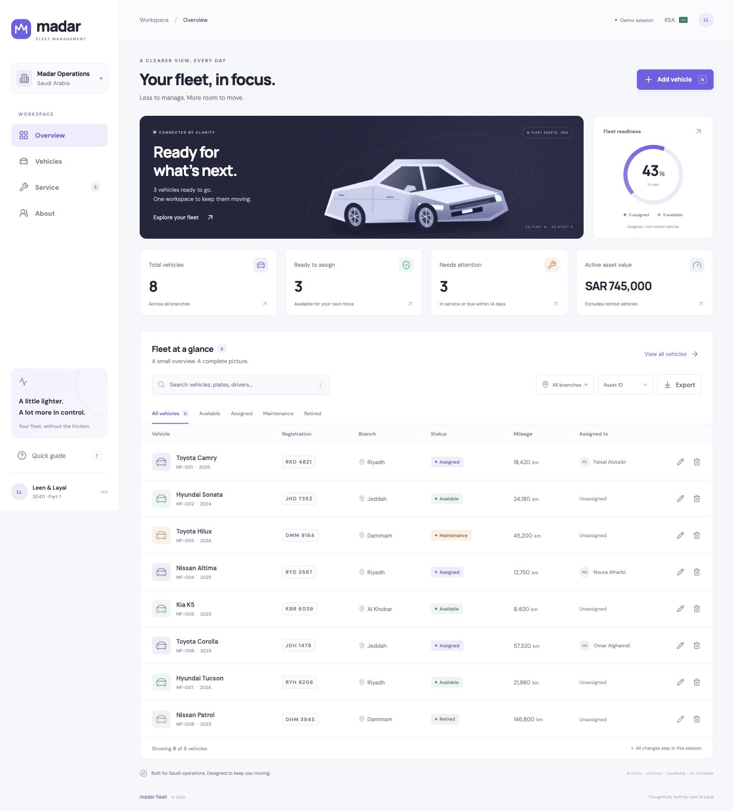

# Madar Fleet

**Your fleet, in focus.** A React frontend for managing company vehicles in a Saudi business setting.

SE411 · Fall 2026–27 · Part 1

| Team member | Student ID |
| --- | --- |
| Leen Alshaya | 221410456 |
| Layal Alhashim | 220511246 |



## Start the application

Install Node.js **22.12+** (Node 24 LTS is also suitable) and npm. From this folder:

```sh
npm ci
npm run dev
```

Open the local URL printed in the terminal. Stop the server with Ctrl+C.

```sh
npm test                 # 81 unit and interaction checks
npm run test:coverage    # includes coverage report
npm run build           # create dist/
npm run preview         # serve the production build
```

The lockfile pins the installed dependency versions. No environment variables, API keys, database, or backend service are required. Fonts, icons, and the vehicle illustration are included locally; the app makes no external runtime requests.

## What you can do

- **Overview:** see total vehicles, availability, service attention, active asset value, and utilization. Select a summary card to open the related view.
- **Vehicles:** add, view, edit, assign, and delete individual company vehicles. Confirm deletion and immediately undo it if needed.
- **Search and filter:** combine search, status, and branch; sort by asset ID, vehicle name, mileage, or service date.
- **Service:** see vehicles in maintenance or with a service date due within 14 days, including overdue vehicles.
- **Export:** download the current filtered view as a UTF-8 CSV.
- **About:** see both team members and their exact student IDs.
- **Quick guide:** learn shortcuts and the session data behavior.

The interface uses a quiet light background, violet accents, an original vector vehicle illustration, compact navigation, and an edit drawer. On phones, records become cards with direct edit/delete controls.

## Part 1 data model

The only asset category is **company vehicles**. Eight fictional records are created by `src/data/vehicles.js` and kept in an array of objects in React state. Adding, editing, and deleting change that collection immediately.

**Refreshing the page restores the sample fleet.** There is deliberately no database, localStorage, sessionStorage, or backend. CSV export keeps a separate copy; CSV import is not implemented. Each browser tab has its own independent session. This follows the assignment’s collection-of-objects requirement.

Saudi context: branches in Riyadh, Jeddah, Dammam, and Al Khobar; asset values in SAR; mileage in kilometres. All records, drivers, registration labels, and amounts are fictional. The interface is English. Arabic text can be entered, but an Arabic interface and full RTL localization are outside this submission.

## Project structure

```text
src/
  App.jsx                     Navigation, views, state and CRUD handlers
  App.test.jsx                User interaction tests
  main.jsx                    React entry point
  styles.css                  Responsive visual system
  components/
    Modal.jsx                 Accessible dialog and focus management
    VehicleForm.jsx           Add/edit drawer and field errors
    VehicleArt.jsx            Original SVG vehicle illustration
  data/vehicles.js             Fictional object collection
  lib/fleet.js                 Validation, filtering, service rules, CSV
  lib/fleet.test.js            Domain behavior tests
  test/setup.js                Testing Library setup
public/
  favicon.svg
  fonts/                      Local fonts and OFL licenses
docs/
  PROJECT-REPORT.md            Architecture, stack, features, data dictionary
  PROJECT-REPORT.pdf           Formatted submission report
  REQUIREMENTS.md              Assignment traceability and acceptance criteria
  TEST-REPORT.md               Actual execution results and browser checks
  DEMO-GUIDE.md                Step-by-step demonstration
  AI-USAGE.md                  Transparent AI assistance record
  GITHUB-SUBMISSION.md         Public repository upload instructions
  evidence/                   Test/build logs and coverage summary
  screenshots/                Screens captured from the running application
```

## Verification

The automated suite covers validation, duplicate registrations, CRUD interactions, assignment rules, filters, service boundaries, empty states, keyboard navigation, CSV quoting/formula protection, and refresh behavior. See [test report](docs/TEST-REPORT.md) for the executed results and limitations.

A GitHub Actions workflow repeats `npm ci`, `npm test`, and `npm run build` on pushes and pull requests. It requires a repository that permits Actions; a cloud run is not claimed before uploading.

## Submission

Upload **this folder’s contents** to a **public GitHub repository**. Follow [GitHub submission steps](docs/GITHUB-SUBMISSION.md). Do not upload `node_modules/`, `.git/`, `coverage/`, or local runtime files. One student submits the public repository URL.

**Team-size check:** the brief specifies three to four students; only the two supplied members are listed. Confirm approval for a two-person team or add the remaining actual members before submission. No identities or contribution allocations have been invented.

## Next phase

Part 2 calls for a manually coded backend. The pure domain functions and explicit record shape provide a starting point, but no server, database, login, or backend implementation is included here.

## Credits

AI assistance: OpenAI Codex, used for requirement interpretation, design, frontend implementation, tests, and documentation. See [AI usage](docs/AI-USAGE.md). Icons: Lucide (ISC). Fonts: DM Sans and Manrope (SIL Open Font License; license files are bundled). Logo and vehicle illustration: original SVG created for this project. React and other dependencies retain their respective licenses.
