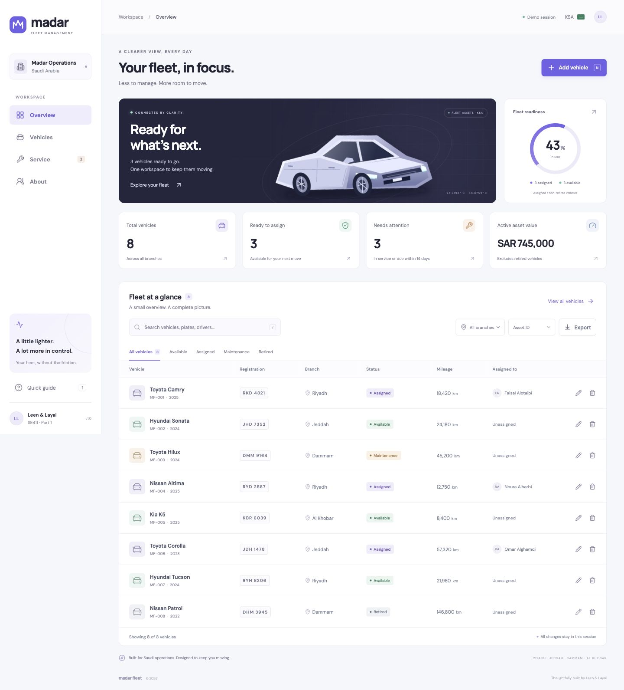

# Madar Fleet

**Your fleet, in focus.** A vehicle asset management application for Saudi businesses, with a React frontend and a Spring Boot REST API backed by H2.

SE411 · Fall 2026–27 · Parts 1 and 2

| Team member | Student ID |
| --- | --- |
| Leen Alshaya | 221410456 |
| Layal Alhashim | 220511246 |



## Repository structure

```text
frontend/                     React, Vite, frontend tests and bundled fonts
  docs/CONNECTED-VERIFICATION.md
  docs/part-1-original/        Original Part 1 reports, evidence and screenshots
backend/                      Spring Boot Maven project; open this in NetBeans
  src/main/                   REST API, vehicle rules and H2 persistence
  src/test/                   JUnit, Mockito and HTTP integration tests
  docs/API.md                 API routes, examples and validation
  docs/VERIFICATION.md
.github/workflows/ci.yml       Frontend and backend checks
```

The original standalone Part 1 submission remains available at the [`part-1` tag](https://github.com/LEEN221410456/Madar-Fleet/tree/part-1). The `main` branch contains the connected application. Historical Part 1 reports describe the original in-memory frontend; current setup instructions are below.

## Run locally

Install Node.js **22.12 or newer**, **JDK 17 or newer**, and **Maven 3.9 or newer** (NetBeans' bundled Maven also works). The first dependency installation needs internet access.

Clone the repository and start the backend:

```sh
git clone https://github.com/LEEN221410456/Madar-Fleet.git
cd Madar-Fleet/backend
mvn spring-boot:run
```

In a second terminal, from the repository root:

```sh
cd frontend
npm ci
npm run dev
```

Open the URL printed by Vite, normally **http://127.0.0.1:5173**. The header shows **Connected to Spring** when the API responds. Vite forwards `/api` requests to **http://127.0.0.1:8080**. No API key or separate database installation is needed.

For NetBeans, open the **`backend` folder containing `pom.xml`** as an existing Maven project and choose **Run**. Run React separately with the commands above. See the [frontend guide](frontend/README.md) and [backend guide](backend/README.md) for port overrides and troubleshooting.

The backend creates a local file database in `backend/data/` when launched from that folder and seeds eight fictional vehicles on an empty database. Changes survive a restart when the same database path is used. Local databases and generated build files are ignored by Git.

## Features

- Fleet overview with whole-fleet totals, availability, service attention and asset values in SAR.
- Create, find by asset ID, update and paginate vehicle records through the REST API.
- Search, branch/status filters, sorting, service views and CSV export across matching pages.
- Server-backed removal and Undo, responsive vehicle cards and accessible forms.

This repository supplies a local application. A production frontend build needs a host that serves the frontend and routes `/api` to the backend; Vite's development proxy is configured for `npm run dev`.

## Verify

From the repository root:

```sh
npm --prefix frontend ci
npm --prefix frontend test
npm --prefix frontend run build
mvn -f backend/pom.xml clean verify
```

GitHub Actions runs frontend checks with Node 24 and backend checks with Java 17 on pushes and pull requests. The backend HTTP integration tests use a temporary in-memory database. See [current repository verification](docs/VERIFICATION.md) for locally executed results.

## Credits and project context

The original Git history and Part 1 documents are preserved. AI assistance was used for the frontend, backend, tests and documentation; see [the original AI usage record](frontend/docs/part-1-original/AI-USAGE.md) and [the backend disclosure](backend/README.md). Third-party frontend licenses are described in [the notices](frontend/THIRD-PARTY-NOTICES.md).
